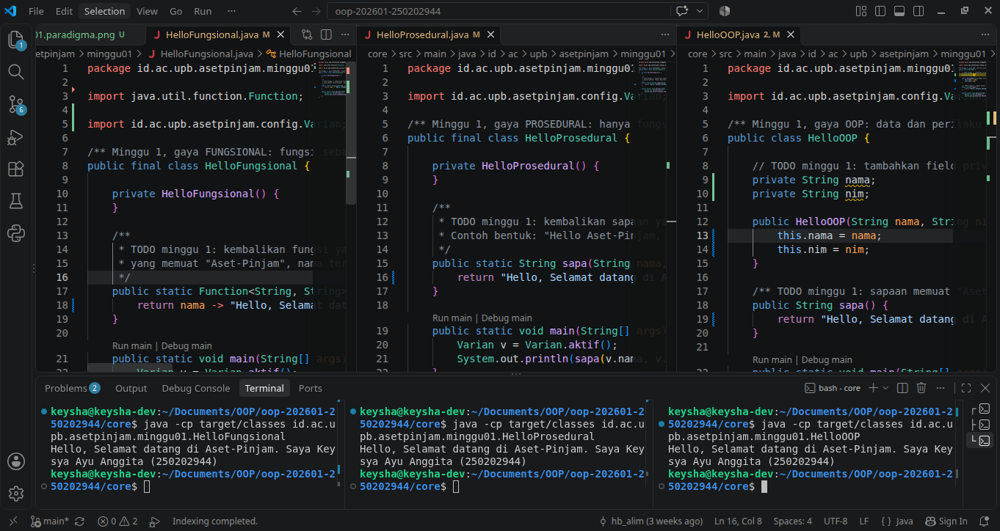
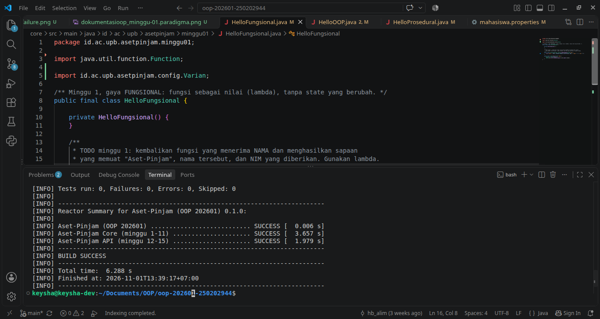

# Catatan Minggu-01: Paradigma Pemrograman dan Setup

## Yang saya kerjakan
Pada minggu pertama, saya menyiapkan kebutuhan pemrogaman Java dengan menggunakan JDK 21 dan Maven. Saya mengerjkan tiga program dengan paradigma pemrograman yang berbeda, yaitu `HelloFungsional.java`, `HelloOOP.java`, dan `HelloProsedural.java` pada Aset-Pinjam. Saya juga mencoba menjalankan masing-masing program untuk memastikan hasilnya menampilkan sapaan yang berisi nama dan NIM. Setelahnya saya menjalankan pengujian menggunakan perintah `bash scripts/uji.sh`.

## Keputusan desain
Saya mengerjakan tiga program paradigma yang berbeda, yaitu Fungsional menggunakan lambda, OOP menggunakan class, objek, konstruktor dan lambda, serta prosedural menggunakan method static. Ketiganya menggunakan `nama` dan `nim` dari file `mahasiswa.properties` serta menghasilkan format sapaan yang sama.

## Kendala
Pada awal pengerjaan, saya mengalami kesulitan dalam menyiapkan Java di Ubuntu. Awalnya versi Java yang digunakan adalah JDK 26, sedakan proyek menggunakan JDK 21. Kemudian yang saya lakukan yaitu memasang dan mengatur JDK 21 agar sesuai dengan kebutuhan proyek.

Kendala berikutnya yaitu mengisi bagian `TODO` karena masih mempelajari penggunaan lambda, konstruktor dan static, serta langkah-langkah dalam pengerjaannya. Ketika saya menjalankan pengujian menggunakan `bash scripts/uji.sh`, muncul hasil `BUILD FAILURE`. Setelah memeriksa laporan pengujian, saya menemukan dua dari lima pengujian yang gagal karena tidak sesuai dengan format yang diharapkan oleh penguji. Saya perlu menyamakan penulisan huruf, tanda baca, isi sapaan dan lambda.  

## Penggunaan AI
- Alat yang dipakai: ChatGPT.
- Bagian yang dibantu AI: Pengaturan JDK 21 dan Maven, serta melengkapi `pembuatSapaan()` pada ketiga file Java.
- Prompt utama: Jelaskan Minggu-01 secara lengkap, jelas dan mudah dipahami. Dan jelaskakan langkah-langkah dalam pengerjaannya secara bertahap, bantu saya menyelesaikan bagian kode yang diperlukan.
- Yang saya ubah atau tolak dari saran AI, dan alasannya: Saya mencoba mengubah kalimat sapaan pada ketiga program tetapi setelah menjalankan mpengujian, hasilnya tidak sesuai dengan format yang ditentukan. Oleh karena itu, saya perlu mengembalikan format sapaan agar ketiga program dapat lolos pengujian.
- Satu hal yang saya pahami lebih baik sekarang: Saya mulai memahami perbedaan tiga paradigma pemrograman Java, yaitu Fungsional yang memanfaatkan lambda (`->`), OOP menggunakan class dan objek, serta Prosedural yang menggunakan metode. Selain itu, saya belajar bahwa keberhasilan menjalankan program belum tentu program tersebut sudah memenuhi semua pengujian.

## Dokumentasi

