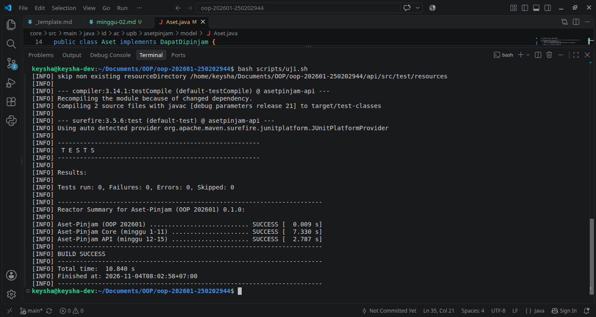

# Catatan Minggu-02: Class, Object, dan Encapsulation

## Yang saya kerjakan
Melengkapi bagian `TODO` pada file `Aset.java` untuk Minggu-02, yaitu menambahkan atribut `private`, melengkapi konstruktor, getter, dan setter untuk mengatur data set. Saya juga menambahkan validasi agar kode dan nama tidak boleh kosong atau null, serta status dan kondisi tidak boleh null.

## Keputusan desain
Saya menggunakan `private` pada setiap atribut agar data tidak dapat diubah secara langsung. Saya juga menggunakan `trim()` untuk menghilangkan spasi di awal dan akhir teks.

## Kendala
Saya mengalami kesalahan pada bagian konstruktor sehingga program tidak berhasil dijalakan. Namun, setelah diperbaiki, program berhasil dijalankan.

## Penggunaan AI
- **Alat yang dipakai:** ChatGPT
- **Bagian yang dibantu AI:** Getter,setter, konstruktor, validasi pada `Aset.java`.
- **Prompt utama:** Jelaskan pengerjaan pada minggu-02, bantu saya melengkapi `TODO` pada minggu-02 sesuai dengan ketentuan yang tertulis, dan kenapa menggunakan `trim()` pada validasi `kode` dan `nama`.
- **Yang saya ubah atau tolak dari saran AI, dan alasannya:** Menyesuaikan kode dengan ketentuan tugas pada minggu ini agar sesuai dengan kebutuhan program dan mempertahankan method pada minggu 3, 4, dan 5, karena belum termasuk dalam tugas minggu ini.
- **Satu hal yang saya pahami lebih baik sekarang:** Saya memahami konsep encapsulation, yaitu melindungi data di dalam class menggunakan `private`. Untuk mengakses atau mengubh data tersebut, digunakan getter dan setter. Saya juga memahami fungsi konstruktor untuk memberikan nilai awal pada objek dan penggunaan `trim()` untuk menghilangkan spasi di awal dan akhir teks sebelum dilakukan validasi.

## Dokumentasi

